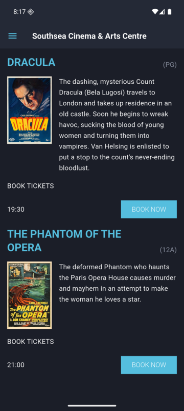
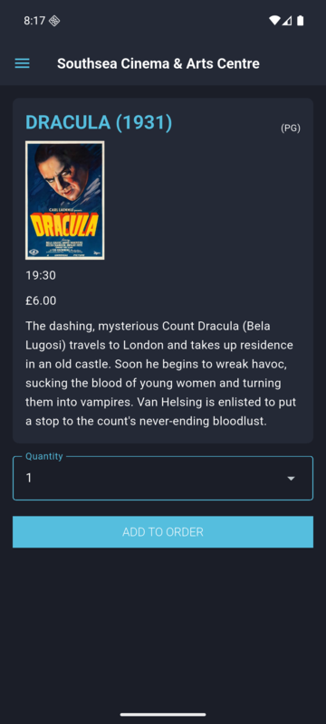
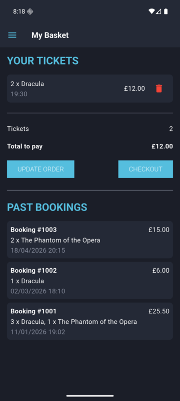
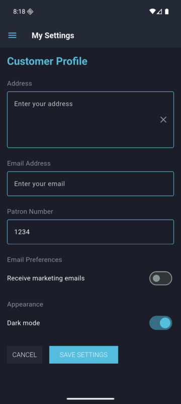

# Southsea Cinema

A Flutter app for browsing the films showing at Southsea Cinema, adding tickets to a basket, and saving completed bookings. The app is set up for Android only.

This is coursework for the **Programming Applications and Programming Languages (M30235)** and **User Experience Design and Implementation (M32605)** modules at the University of Portsmouth. It recreates a mobile version of the [Southsea Cinema website](https://southseacinema.savoysystems.co.uk/SouthseaCinema.dll/).

## Features

- Browse the films loaded from the bundled `assets/data/movies.json` file, each with its poster, age rating, description and screening time.
- Open a film, choose how many tickets to buy and add them to the basket.
- Review the basket, remove tickets, see the ticket count and total to pay, and check out.
- View past bookings. Bookings are stored locally in SQLite; the basket is held in memory.
- Save customer profile details and preferences on the device, including marketing emails and a dark mode setting.

## Platform

The app runs on Android only, because it saves bookings in a SQLite database file on the device. Use an Android emulator or a physical Android device. Running it in a browser or on a desktop is not supported.

## Getting started

### Prerequisites

- [Flutter](https://docs.flutter.dev/get-started/install) with the Android toolchain set up.
- An Android emulator or device.
- Git.

### Clone

```bash
git clone https://github.com/KiloOscarSix/southsea_cinema.git
cd southsea_cinema
```

### Install dependencies

```bash
flutter pub get
```

### Run

Start an Android emulator or connect a device, then run:

```bash
flutter run
```

## Tests

Run the automated unit and widget tests with:

```bash
flutter test
```

These tests use in-memory SQLite databases and do not require an Android emulator. Running the app itself does require an Android emulator or device.

To measure test coverage, run `flutter test --coverage`. The report is written to `coverage/lcov.info`.

## Project structure

- `lib/main.dart` sets up the app, its routes and the light and dark themes.
- `lib/models/` holds the data classes, such as `Movie`, `BasketItem`, `Booking` and `UserSettings`.
- `lib/repositories/` holds the film list loaded from JSON and the in-memory basket.
- `lib/database/` holds the SQLite database for saved bookings.
- `lib/views/` holds the home, film, basket and settings screens.
- `lib/widgets/` holds the reusable button, the film card and the navigation drawer.
- `assets/` holds the film posters and the `movies.json` data file.
- `test/` mirrors the folders in `lib/`.

## Screenshots

### Home

The home page lists the films that are currently showing, each with its poster, age rating, description and screening time.



### Booking

Tapping **Book now** opens the film's page, where the user chooses how many tickets to add to their order.



### Basket

The basket shows the tickets added, the ticket count and the total to pay. Below it, the user can see their past bookings.



### Settings

The settings page saves the customer's address, email, marketing preference and dark mode choice on the device.


